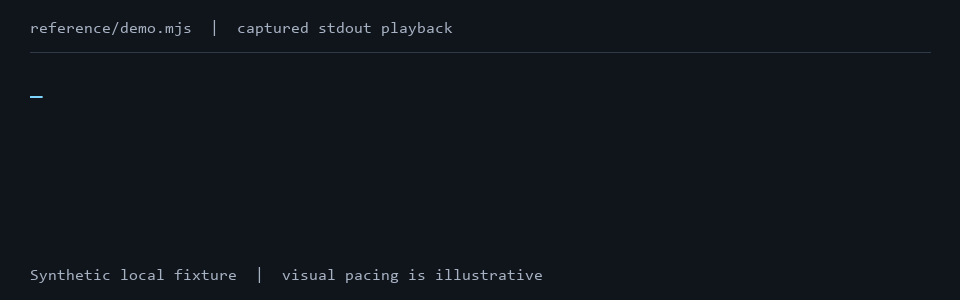

# AMQIC Base Cybersecurity for Development

[](LICENSE)
[](https://github.com/MrMarshalRF/amqic_base_cybersec_for_development/stargazers)
[](https://github.com/MrMarshalRF/amqic_base_cybersec_for_development/forks)
[](https://github.com/MrMarshalRF/amqic_base_cybersec_for_development/issues)

> **You can verify every release file.** First authenticate the signed [SHA256SUMS](SHA256SUMS) registry through [AMQIC verification](https://amqic.ai/pages/request-verification). Then compare the SHA-256 of each release file with its registry entry.
>
> The [VirusTotal scan register](VIRUSTOTAL.md) provides per-file reports and SHA-256 values for all 127 files in the scanned snapshot. The [JSON report](VIRUSTOTAL.json) includes individual engine results.

> **Basic cybersecurity protection.** The measures presented here provide a baseline level of cybersecurity protection. You can substantially extend these capabilities to address a broader range of potential threats. These solutions are intended to help significantly reduce the risk of successful cyberattacks against your applications and systems.

**This is a reusable toolkit, not a standalone application.** It contains independent cybersecurity measures, runnable examples, infrastructure templates, release tools, and AI skills. They are not tied to one product or architecture: select the relevant parts and integrate them into different applications, services, or individual components. You may copy, adapt, and modify them for your own requirements under the MIT license. Match each example to your target runtime and integration contracts; adopting one component does not require adopting the entire kit.

Repository copyright holder — **amqic.ai**. License — [MIT](LICENSE).

Developer — **Aleksei Musienko**

Quantum Information & Artificial Intelligence & Mathematical Physics Scientist | Chief Scientist & Head of AMQIC | Q-Developer & SEC Architect | [amqic.ai](https://amqic.ai)

## One command for people and AI agents

[The complete local lab](docs/ALL-LAB.md) exposes a side-effect-free JSON plan and a fixed all-local runner:

```sh
node scripts/verify.mjs --plan
node scripts/verify.mjs --all --prepare --output /absolute/external/all-local.json
```

On Linux/macOS, the convenience entry is `sh lab/run.sh`; it chooses a new external report directory and runs the same fixed all-local plan. [Host prerequisites and visible parameters](lab/host-requirements.md) explain the machine requirements and every configuration boundary.

`--prepare` explicitly authorizes only the pinned lab prerequisites. The [scenario catalogue](lab/scenarios.json), [JSON protocol schema](lab/protocol.schema.json) and [AI skill](skills/run-security-lab/SKILL.md) make prerequisites, actions, results and cleanup machine-readable. Local tests and external/manual provider checks remain distinct.

## Run and verify the implementation

The [reproducible lab](docs/REPRODUCIBLE-LAB.md) runs a real HTTP form, server-enforced synthetic login, parameterized storage, an upload/quarantine/promotion flow, the ClamAV protocol and a browser consumer. Its automatic mode also checks a real Redis limiter. Use the pinned prerequisites and a new external report path:

```sh
node --experimental-sqlite lab/run-lab.mjs --verify --output /absolute/external/live-result.json
node scripts/verify.mjs --full --output /absolute/external/whole-kit-result.json
```

Every payload file is classified in [coverage.json](verification/coverage.json). [Claims and limitations](verification/claims.json) connect mechanisms to named checks and standards. The [completion protocol](verification/v1.2.0-report.json) records final observed results. Executable references, configuration templates and source-reviewed guides are distinct; a guide is not counted as a deployed control. Hosted CI is configured, not claimed to have run before publication.

## Who this is for

Developers building web applications, APIs, MCP integrations, and containerized services who want a concrete baseline before production. The runnable examples and step-by-step templates are intended for developers who are starting to formalize their security practices.



Captured output from `node --experimental-sqlite reference/demo.mjs`, played back with illustrative pacing.

New to cybersecurity? Start with [Security basics, explained simply](docs/SECURITY-BASICS.md): how each protection works, a practical example, and what it does not guarantee.

See the [changelog](CHANGELOG.md) for additions, changes, validation notes and release history.

## Signed release verification

Official releases use a post-quantum electronic signature on the [SHA256SUMS file registry](SHA256SUMS). Validate that signed registry at [amqic.ai/pages/request-verification](https://amqic.ai/pages/request-verification), then compare the SHA-256 of every release file with its registry entry. The maintainer signs the final registry before publication. See [release verification](docs/RELEASE-VERIFICATION.md) for the scope and checks.

Report suspected vulnerabilities privately to [cyber@amqic.ai](mailto:cyber@amqic.ai). The [security policy](SECURITY.md) describes response targets and coordinated disclosure.

## What is included

| Area | Implementation and guide | Related risks and references |
| --- | --- | --- |
| Server-side authorization | Login → password → CAPTCHA → TOTP → session, single-use stages, attempt limits, and revocation. [Core](reference/README.md) | [A07, A01](docs/OWASP-MAPPING.md) |
| Runnable verification lab | Real HTTP/browser, ClamAV and Redis consumers; fixed whole-kit verifier and CI. [Reproduction](docs/REPRODUCIBLE-LAB.md) | [Evidence boundaries](verification/claims.json) |
| Request admission reference | Bound single-use proof of work, SQLite replay store and fixed Redis rate limiter. [Admission](lab/admission.README.md) | [NIST SC-5 scope](verification/claims.json) |
| Website personal-data forms | Strict server schema, bounded Unicode input and fixed parameterized storage; safe output/container integration guidance. [Web input protection](docs/WEB-INPUT-PROTECTION.md) | [A05, A01](docs/OWASP-MAPPING.md) |
| Embeddable login | A framework-independent client controller with protection against duplicate submissions and stale responses. [Controller](reference/login-client.mjs) | [A07, A10](docs/OWASP-MAPPING.md) |
| Machine identity | Ed25519 signatures bound to the request, audience, timestamp, body, and nonce, with persistent replay protection. [Core](reference/README.md) | [A07, A04, A08](docs/OWASP-MAPPING.md) |
| Sensitive operations | Fresh TOTP verification, a single-use grant for the exact action and arguments, and idempotent retries. [Core](reference/README.md) | [A01, A06](docs/OWASP-MAPPING.md) |
| API/MCP | A fixed tool catalog, authorization checks, and transport integration contracts. [Integration](reference/README.md) | [A01, A07](docs/OWASP-MAPPING.md) |
| External web protection | Cloudflare edge/CDN example, safe caching, DDoS concepts, WAF/rate limits and restricted origin. [Cloudflare guide](docs/CLOUDFLARE-EDGE.md) | [A02, A06](docs/OWASP-MAPPING.md) |
| Nginx origin | HTTPS, Host/SNI checks, blocked paths, a sensitive URI registry, CSP, and 429 responses. [Infrastructure](docs/INFRASTRUCTURE.md) | [A02, A05](docs/OWASP-MAPPING.md) |
| Initial deployment | Proxying before public launch, closed ports, key-only SSH, and CIDR firewall rules. [Deployment](docs/INITIAL-DEPLOYMENT.md) | [A02](docs/OWASP-MAPPING.md) |
| Whitelisting | Access restrictions by TCP peer or by end-client address through an explicitly trusted proxy. [Deployment](docs/INITIAL-DEPLOYMENT.md) | [A01, A02](docs/OWASP-MAPPING.md) |
| Containers | A minimal image, a non-root UID, a read-only filesystem, and capability, network, and resource limits. [Infrastructure](docs/INFRASTRUCTURE.md) | [A02](docs/OWASP-MAPPING.md) |
| Dependencies | Separate download and offline inspection stages, artifact inventory checks, and approval of exact bytes. [Operations](docs/OPERATIONS.md) | [A03, A08](docs/OWASP-MAPPING.md) |
| Secrets | Hidden human input, encrypted storage, and metadata for AI agents. [Operations](docs/OPERATIONS.md) | [A02, A04](docs/OWASP-MAPPING.md) |
| Backups | Explicit file selection, a manifest, restore verification, and AES-256-GCM. [Operations](docs/OPERATIONS.md) | [A04, A08](docs/OWASP-MAPPING.md) |
| Password management | KeePassXC, KDBX, separate factor storage, and recovery. [KeePassXC](docs/KEEPASSXC.md) | [A04, A07](docs/OWASP-MAPPING.md) |
| Production preparation | A new clean release directory, exclusion of Git/Graphify/internal files, and checks for common secret patterns. [Preparation](docs/PRODUCTION.md) | [A02, A08](docs/OWASP-MAPPING.md) |
| Binary release protection | Symbol separation, version-specific obfuscation examples, private diagnostics, and final-byte verification. [Binary guide](docs/BINARY-OBFUSCATION.md) | [Resilience and SSDF scope](docs/BINARY-OBFUSCATION.md#standards-and-evidence) |
| VPN administration | WireGuard/WireSock and Tailscale patterns, restricted access, and source-address verification. [VPN guide](docs/VPN-TUNNELS.md) | [Network boundaries](docs/VPN-TUNNELS.md) |
| Upload isolation | Separate quarantine, verdict and approved-content volumes; distinct intake/scanner/promoter/media identities. [Upload guide](docs/UPLOAD-ISOLATION.md) | [ASVS upload / NIST mapping](SECURITY.md#standards-mapping-for-the-v11-additions) |
| Malware scanning | ClamAV quarantine, update, coverage and failure-policy guidance. [Service protection](docs/SERVICE-PROTECTION.md) | [Layered resource and content checks](docs/SERVICE-PROTECTION.md) |
| Shared admission state | Private Redis, ACL/TLS, replay-state durability and gateway proof-of-work design guidance. [Service protection](docs/SERVICE-PROTECTION.md) | [Resource-consumption limits](docs/SERVICE-PROTECTION.md#request-proof-of-work-at-a-gateway) |
| Version currency | Node/Python, supported npm/PyPI dependencies, official metadata, and dated snapshots. [Versions](docs/VERSIONS.md) | [A03](docs/OWASP-MAPPING.md) |


## OWASP reference map

The feature table above is cross-referenced to selected **OWASP ASVS 5.0.0** requirements and **OWASP Top 10:2025** categories in the [OWASP mapping](docs/OWASP-MAPPING.md). Each row distinguishes executable examples, configuration templates, and application integration work. The mapping is a review aid and records partial relationships; it does not establish an ASVS level or OWASP certification.

## Requirements

Choose current patched releases from supported runtime branches and run the kit checks on the target versions. The core was tested with Node.js 22.14.0 and `node:sqlite`. The SQLite module is experimental in this tested version. The example has no npm dependencies. Python helpers use the standard library, with baseline support starting at Python 3.11. Production preparation on Windows requires Python 3.12+.

The infrastructure instructions target Linux, OpenSSH, Nginx, and Docker Compose. Trusted-proxy client whitelisting requires `http_realip_module`. The Nginx test environment uses a local image identified by a reviewed SHA-256 and synthetic TLS certificates. Encrypted backup and secret input commands are intended for a human operator's own interactive Linux terminal.

Tested versions, environments, and limitations are listed in [VALIDATION.md](docs/VALIDATION.md). Before a release, check current patches and branch support using [VERSIONS.md](docs/VERSIONS.md).

## Quick start

Open a terminal in the kit's root directory. These commands run checks against synthetic data.

```sh
node --experimental-sqlite reference/demo.mjs
node --experimental-sqlite --test reference/core.test.mjs reference/login-client.test.mjs reference/pii-input.test.mjs
python -B scripts/test_operations.py
node --test scripts/test_crypto.mjs
python -B scripts/test_prepare_production.py
python -B scripts/test_check_versions.py
python -B infra/container/test_quarantine.py
python -B infra/nginx/test_harness.py
```

The demo completes the login flow, performs a signed authorized operation, and retries using the same operation identifier. The `sameResult=true` response confirms that the stored result was returned. The CAPTCHA adapters, passwords, and TOTP fixtures in `reference/fixtures.mjs` are used exclusively by synthetic examples.

## Adoption sequence

1. Read the [security model](docs/SECURITY-MODEL.md) and define system ownership, access boundaries, and recovery.
2. For a new server, start with [initial deployment](docs/INITIAL-DEPLOYMENT.md). Configure the cloud firewall, administrative access, and origin TLS before publishing proxied DNS records.
3. Create a dedicated account and an Ed25519 SSH key, then verify a second session and the provider console. Allow the SSH port only from administrative CIDRs or a VPN. `sshd` verifies the key.
4. Prepare the application and its internal container network. Choose non-overlapping address ranges and verify that Nginx can reach the private address on the target Linux host.
5. Generate a candidate Nginx configuration with the actual domain and private upstream. Enable whitelisting where needed. Check syntax, permitted requests, denials, rate limits, and CSP.
6. Integrate the server core through the contracts in [reference/README.md](reference/README.md). Connect a real CAPTCHA provider, protected factor storage, enrollment, and recovery.
7. Set up hidden secret input, backups, and restore verification. Critical changes require independent 2FA confirmation bound to the specific operation.
8. Check versions and dependencies, prepare a clean release inventory, and test the application with its target configuration.
9. Follow a separately authorized release procedure with a rollback plan and monitoring.

## Integrating authorization and API/MCP

`reference/core.mjs` contains the server core, `reference/crypto.mjs` provides cryptographic functions, and `reference/login-client.mjs` controls the login stages presented by the interface. Each login stage requires server confirmation. The flow has no option to disable stages for simplified login.

A sensitive-operation handler receives a grant bound to the user, session, action, argument hash, and operation identifier. The example changes synthetic records within the same SQLite transaction. External effects, including deleting a production database or backup files, require a separately reviewed handler with durable outcome tracking.

The application supplies the complete HTTP/MCP transport, OAuth integration, and browser-facing server. Machine Ed25519 signatures belong to the internal protocol, while MCP transport authorization requires its own integration. CAPTCHA, cookie, CSRF, factor storage, scope, revocation, and idempotency contracts are documented in the [core guide](reference/README.md).

## Origin protection, rate limits, and CSP

The baseline Nginx configuration permits only explicitly selected routes. The `infra/protected-paths.json` registry additionally blocks known paths to secrets, source files, and internal data. Direct requests with an inappropriate Host or SNI are rejected.

The starting website limit is 10 requests per second per IP. `/api` and `/mcp` share a separate starting limit of 10 requests per minute per IP. Tune these values and burst capacity to the application workload, trusted proxy setup, and expected shared-IP traffic, then rerun the rate-limit tests before deployment. Each zone uses `burst=9 nodelay`, allowing an initial batch of up to ten nearly simultaneous requests. Excess requests receive 429. Capacity recovers according to the leaky-bucket algorithm. Blocked HTTP paths also pass through the limiter. TLS and early HTTP parsing failures have their own processing boundary.

CSP allows core resources from the same origin and restricts inline code, `eval`, frames, plugins, workers, and media. The policy is also included in denial responses. A stricter application CSP is retained alongside the baseline policy. External CAPTCHA, CDN, API, WebSocket, or nonce/hash integration requires coordinated policy changes and interface testing. Configuration and the reproducible test environment are described in [INFRASTRUCTURE.md](docs/INFRASTRUCTURE.md).

Whitelisting has separate profiles for the immediate connection peer and a client address restored through a trusted proxy. A header supplied by an arbitrary sender does not establish trust. The network firewall restricts ports and SSH reachability, while OpenSSH verifies keys. Every template requires explicit operator-provided settings.

## Backups and secrets

The primary backup entry point is `scripts/secure_backup.mjs`. It creates a private intermediate archive, encrypts it with AES-256-GCM, and verifies decryption and contents. A human enters the password without echo. Restore creates a new directory. A running database requires a native consistent dump or snapshot.

`protected_input.mjs` demonstrates hidden input and encrypted storage. Enforced isolation from an agent with full access under the same OS user requires a separate trusted process under another account or an external secret store. The application's secret consumer is integrated separately. Never pass secrets through chat, command arguments, environment variables, or logs. Detailed commands and limitations are in [OPERATIONS.md](docs/OPERATIONS.md).

## AI skills

| Skill | Purpose |
| --- | --- |
| [protected-terminal-input](skills/protected-terminal-input/SKILL.md) | Metadata preparation and hidden human input |
| [verified-backup](skills/verified-backup/SKILL.md) | Encrypted backups and restore verification |
| [review-dependencies](skills/review-dependencies/SKILL.md) | Offline dependency inspection and an exact SHA-256 approval decision |
| [prepare-production](skills/prepare-production/SKILL.md) | A clean release inventory and checks for common secret patterns |
| [check-versions](skills/check-versions/SKILL.md) | Version currency, branch support, and coverage gaps |
| [obfuscate-binaries](skills/obfuscate-binaries/SKILL.md) | Production binary transformations, preserved contracts, private diagnostics, and final signing |
| [run-security-lab](skills/run-security-lab/SKILL.md) | Plan and run the fixed local scenarios and interpret machine-readable evidence |

Give the agent the path to the relevant `SKILL.md`, or install the skill folder through your tool's normal mechanism while preserving access to its relative resources. The skills are part of this kit and reference its `scripts/`, `infra/`, and `docs/` directories. Copying a skill folder alone requires updating those references. Repository agent instructions are in [AGENTS.md](AGENTS.md).

## Production binaries and private administration

Use the [binary obfuscation guide](docs/BINARY-OBFUSCATION.md) to distinguish symbol stripping from actual obfuscation and to preserve diagnostics, runtime compatibility and signing order. It includes Linux ELF and Go metadata-reduction examples, version-bound Garble/R8 templates, and .NET considerations. Obfuscation can increase analysis effort; it cannot protect embedded credentials or replace server-side authorization.

Use the [VPN guide](docs/VPN-TUNNELS.md) for WireGuard with WireSock on Windows or Tailscale, including subnet-router access. Keep SSH and private administrative endpoints restricted by tunnel policy, host firewall and application authorization. A tunnel does not automatically configure Nginx, anonymize an origin, or close public listeners.

## External protection and safe caching

The [Cloudflare edge guide](docs/CLOUDFLARE-EDGE.md) explains network/application DDoS, selective public-asset caching, sensitive-response bypasses, WAF and rate limits, strict origin TLS and proxy-source trust. Cloudflare is an additional layer in front of the existing origin and application controls; caching must never mix one user's personal data with another user's response.

## Website form data and container boundaries

The [web input guide](docs/WEB-INPUT-PROTECTION.md) and [server module](reference/pii-input.mjs) validate contact fields and keep SQL structure fixed while binding all submitted values. Browser output stays plain text; form values never become shell commands or dynamically evaluated code. The guide connects these protections to the constrained server container, least-privilege database access and private networking. Each layer keeps its own checks: container isolation does not replace safe queries or authorization.

## Uploads stay outside primary storage

The [upload-isolation guide](docs/UPLOAD-ISOLATION.md) and [Compose topology](infra/container/uploads.compose.yaml) separate the untrusted intake area from approved content and the main application. Only the trusted promoter can write approved storage, after matching the exact scanned bytes; the media service reads approved content only. The template defines isolation boundaries and requires separately implemented role-specific services.

## Malware scanning and shared request limits

The [service-protection guide](docs/SERVICE-PROTECTION.md) explains ClamAV, Redis and request admission. Runnable [upload/ClamAV](lab/upload-pipeline.README.md) and [PoW/Redis](lab/admission.README.md) references supplement those integration patterns. The lab starts temporary real service consumers; it does not install production services or automatically enable PoW on a production API.

## Secure deployment and GitHub releases

Follow the [production deployment runbook](docs/DEPLOYMENT.md) for signed-artifact verification, recovery, configuration and secrets, compatible migrations, staged rollout, real-path checks and rollback. Follow the [GitHub release guide](docs/GITHUB-RELEASES.md) for README/SECURITY/LICENSE contents, source-versus-binary inventories, deterministic SHA-256 registries, signing, version tags, draft assets and download verification. Publishing a release and activating it in production are separate actions.

## Release preparation and updates

`prepare_production.py` copies only explicitly selected files into a new directory outside the source, checks their contents, and creates a manifest. Git metadata, Graphify output, internal instructions, MCP configuration, tests, caches, backups, and known secret filenames are excluded. Explicitly selecting a prohibited file stops preparation. The source tree is preserved.

Secret detection is limited to supported text formats and known patterns. Manual review and a separate process for binary artifacts are required. Confirmed secret exposure requires revocation or rotation. See the [preparation guide](docs/PRODUCTION.md).

`check_versions.py` distinguishes the current environment, lockfile/requirements versions, and dated official metadata. Its report separately shows the latest release, the current patch in the selected branch, support status, and available withdrawn-release information. Private package names are not sent over the network automatically. Updates go through quarantine, compatibility review, and the normal tests. See the [version guide](docs/VERSIONS.md).

## Operational threat data

[Vallatum-collected telemetry from AMQIC's public site](THREAT-DATA.md) covers 22 October–12 November 2026. It records **17,872 Block decisions** and **787 Managed Challenges**. The Block total includes **8,106 temporary maintenance access denials** and **9,766 decisions from other rules**.

The full report includes the daily chart, **514 distinct scanner and sensitive-target paths**, collection limits, and an investigated origin sample with 71 responses of 404 and one public landing-page response of 200. These are request-level policy observations from the site's deployment, with maintenance activity and sampled diagnostics kept separate. They provide operational context for this kit; the report explains what the data can and cannot establish.

## Verification and readiness boundaries

Local tests cover the core and client controller, backups and encryption, release preparation, version currency, and safe archive inspection. Nginx was checked with synthetic requests, and nftables was checked in a separate network namespace. Exact results are available in [VALIDATION.md](docs/VALIDATION.md).

Before production launch, verify actual certificates, addresses, proxy headers, SSH recovery, network rules, and application compatibility. A container shares the host kernel and continues to execute its own code. A minimal image and restrictions reduce the attack surface. Running untrusted code requires a suitable separate sandbox.

## Contributing and license

Change the relevant module, preserve its contracts, and verify affected behavior through its normal entry points. Synthetic examples must remain clearly identified. Follow [AGENTS.md](AGENTS.md) when contributing source code and documentation.

The repository is distributed under the [MIT license](LICENSE). **Copyright (c) 2026 amqic.ai.** Review the terms of third-party tools and images separately for the components you use.

## Repository activity

<a href="https://www.star-history.com/?repos=MrMarshalRF%2Famqic_base_cybersec_for_development&amp;type=date">
  <picture>
    <source media="(prefers-color-scheme: dark)" srcset="https://api.star-history.com/svg?repos=MrMarshalRF/amqic_base_cybersec_for_development&amp;type=date&amp;theme=dark" />
    <source media="(prefers-color-scheme: light)" srcset="https://api.star-history.com/svg?repos=MrMarshalRF/amqic_base_cybersec_for_development&amp;type=date" />
    
  </picture>
</a>

The chart is generated by [Star History](https://www.star-history.com/) from public GitHub data and refreshes subject to service and image-cache delays. It becomes available once this repository is public.

The badges above display public GitHub repository data.


## Developer perspective

This project supports collaboration between developers and AI, with people retaining responsibility for decisions and support. Read the [developer manifesto](MANIFESTO.md) for the full message and social links.

## Optional support

The address list is also available as [wallets.txt](wallets.txt). First verify the maintainer's signature on [SHA256SUMS](SHA256SUMS) through [AMQIC verification](https://amqic.ai/pages/request-verification), then check that the hash of wallets.txt matches its registry entry before relying on the addresses.

I do not ask for money or sell anything from my own public products. This is part of my code of ethics. However, if anyone would like to support the development of cybersecurity, science, and volunteer work, I am providing cryptocurrency wallet addresses for contributions. Any help, in any amount, would be the best way to thank me for my efforts.

| Asset | Network | Wallet address |
| --- | --- | --- |
| USDT | TRC20 | `TTu2KEobZW3hv8RaX2VaWz4Fkj8hQ1Wjqx` |
| BTC | Bitcoin | `19BvhiToixuGvVsVw1fZTiDdAPnXhHJzG3` |
| ETH | Ethereum | `0xf26b834094b9509d5ec3131759ecb64fb45f7405` |


