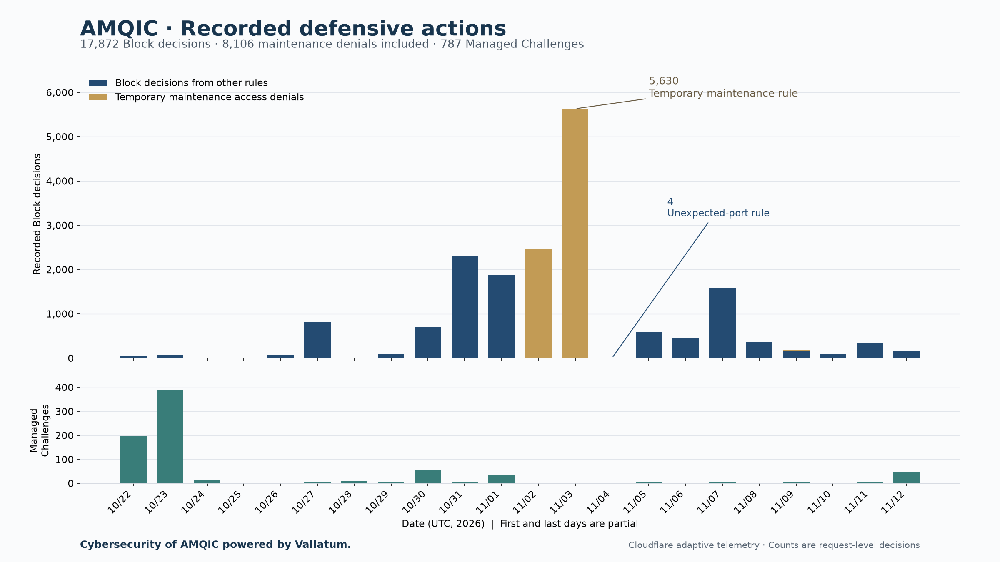

# Threat Data

**21 days of retained telemetry from one public site: 17,872 recorded Block decisions and 787 Managed Challenges.**  
**Of those Block decisions, 8,106 came from temporary maintenance access restrictions; 9,766 came from other rules.**  
**One investigated scan reached the origin with 72 requests: 71 returned 404, and the public landing page returned 200.**

**Cybersecurity of AMQIC powered by Vallatum.**

Aggregate observations from the public website's scanner-defense operation.

**Observation period:** 22 October 2026, 09:30 UTC–12 November 2026, 18:00 UTC.  
**Dataset cutoff:** 12 November 2026, 18:00 UTC.  
**Source:** retained Cloudflare security-event aggregates and a bounded diagnostic sample collected by the site's security monitor.

The retained record starts while the public domain was serving a placeholder and continues through subsequent application releases. It covers the available public-site operation history. The exact initial launch timestamp has not been independently established, so this document makes no claim about activity before the first retained interval.

## Recorded defensive actions

| Action | Provider-reported count |
|---|---:|
| Requests with a Block action | 17,872 |
| Requests with a Managed Challenge action | 787 |
| Managed Challenge events marked non-interactively solved | 11 |
| Managed Challenge events marked bypassed | 24 |
| Log-only events | 2 |

The headline observation is **17,872 recorded Block decisions**, including **8,106 temporary maintenance access denials** and **9,766 decisions from other rules**. These are request-level decisions. They do not establish 17,872 separate attacks, distinct actors, or confirmed malicious visitors.

The challenge counts describe recorded actions and outcomes. A challenge being issued does not establish that it was failed. The outcome categories are retained separately and are not added to the block count.

177,804 Skip events are scoped exceptions (authenticated monitoring, machine API, managed-rule) and are excluded from threat totals.

## Daily defensive-action counts

Dates are UTC. The first and last dates are partial days.

| Date | Block | Managed Challenge |
|---|---:|---:|
| 2026-10-22 | 44 | 196 |
| 2026-10-23 | 80 | 390 |
| 2026-10-24 | 1 | 15 |
| 2026-10-25 | 14 | 1 |
| 2026-10-26 | 71 | 2 |
| 2026-10-27 | 811 | 4 |
| 2026-10-28 | 0 | 9 |
| 2026-10-29 | 83 | 6 |
| 2026-10-30 | 709 | 55 |
| 2026-10-31 | 2,311 | 7 |
| 2026-11-01 | 1,870 | 33 |
| 2026-11-02 | 2,466 | 0 |
| 2026-11-03 | 5,630 | 1 |
| 2026-11-04 | 4 | 0 |
| 2026-11-05 | 581 | 5 |
| 2026-11-06 | 442 | 2 |
| 2026-11-07 | 1,585 | 6 |
| 2026-11-08 | 366 | 0 |
| 2026-11-09 | 192 | 6 |
| 2026-11-10 | 100 | 0 |
| 2026-11-11 | 349 | 4 |
| 2026-11-12 | 163 | 45 |
| **Total** | **17,872** | **787** |

A zero in this table means no action of that type was reported in the retained intervals for that date. It does not establish absence of attempts or traffic.

### Why November 4 dropped to four Blocks

All 5,630 Block decisions on November 3 came from the temporary owner-only maintenance rule. On November 4, the four Block decisions came from the unexpected-port rule. Both dates have a full 24 hours of retained coverage, with no query-limit hit. The change in the chart is a change in the observed policy decisions; it does not establish that attacks fell by the same amount or that a particular fix caused the decline.

Across the complete period, the maintenance rule produced 2,450 denials on November 2, 5,630 on November 3 and 26 on November 9. These are explicitly separated in the chart.

## Scanner and sensitive-target probes

This register retains only requests targeting credential files, configuration and diagnostics, database exports, backups, development artifacts, or endpoints associated with unsupported software stacks. Ordinary pages, SEO endpoints, public APIs, published media, fonts, brand assets and routine authentication navigation have been removed. Ambiguous clean navigation paths are omitted.
The filtered register contains **514 distinct path strings and 1,680 stored records**: **1,537 Block records** and **143 Managed Challenge records**. These figures describe the retained diagnostic sample. They do not alter the full security-action totals above.

Paths preserve observed spelling, case, encoding and repeated separators. Opaque identifiers remain replaced. Entry IDs retain their source-snapshot numbering, so gaps are intentional. Appearance here identifies the type of probe; it does not identify its operator or establish successful access.

Expand all 514 scanner and sensitive-target paths

| Entry | Observed probe path | Block sample records | Managed Challenge sample records | Total sample records |
|---|---|---:|---:|---:|
| P004 | <code>/.env</code> | 69 | 5 | 74 |
| P005 | <code>/.git/config</code> | 56 | 11 | 67 |
| P008 | <code>/.env.local</code> | 39 | 2 | 41 |
| P009 | <code>/.env.prod</code> | 29 | 3 | 32 |
| P010 | <code>/.env.dev</code> | 28 | 1 | 29 |
| P013 | <code>/wp-json/batch/v1</code> | 21 | 0 | 21 |
| P014 | <code>/.git/HEAD</code> | 18 | 1 | 19 |
| P016 | <code>/config.json</code> | 18 | 0 | 18 |
| P017 | <code>/wp-login.php</code> | 15 | 3 | 18 |
| P019 | <code>/phpinfo.php</code> | 17 | 0 | 17 |
| P020 | <code>/.svn/wc.db</code> | 16 | 0 | 16 |
| P024 | <code>/.aws/credentials</code> | 15 | 0 | 15 |
| P025 | <code>/index.php</code> | 15 | 0 | 15 |
| P028 | <code>/wp-config.php</code> | 14 | 0 | 14 |
| P032 | <code>/.svn/entries</code> | 12 | 0 | 12 |
| P033 | <code>/actuator/env</code> | 12 | 0 | 12 |
| P034 | <code>/gcp-credentials.json</code> | 12 | 0 | 12 |
| P035 | <code>/wp/</code> | 12 | 0 | 12 |
| P036 | <code>/.env.production</code> | 10 | 1 | 11 |
| P041 | <code>/wordpress/</code> | 11 | 0 | 11 |
| P042 | <code>/wp-json/</code> | 11 | 0 | 11 |
| P044 | <code>/credentials.json</code> | 10 | 0 | 10 |
| P046 | <code>/xmlrpc.php</code> | 9 | 1 | 10 |
| P047 | <code>/.aws/config</code> | 9 | 0 | 9 |
| P048 | <code>/.vscode/sftp.json</code> | 9 | 0 | 9 |
| P049 | <code>//cms/wp-includes/wlwmanifest.xml</code> | 9 | 0 | 9 |
| P050 | <code>/cms/wp-json/</code> | 9 | 0 | 9 |
| P051 | <code>/database.sql</code> | 9 | 0 | 9 |
| P052 | <code>/info.php</code> | 9 | 0 | 9 |
| P053 | <code>/livewire/update</code> | 9 | 0 | 9 |
| P054 | <code>/wordpress/wp-json/</code> | 9 | 0 | 9 |
| P055 | <code>/.docker/config.json</code> | 8 | 0 | 8 |
| P056 | <code>/.hg/store/requires</code> | 8 | 0 | 8 |
| P057 | <code>//site/wp-includes/wlwmanifest.xml</code> | 8 | 0 | 8 |
| P058 | <code>//wp1/wp-includes/wlwmanifest.xml</code> | 8 | 0 | 8 |
| P059 | <code>//xmlrpc.php</code> | 4 | 4 | 8 |
| P060 | <code>/api/.env</code> | 8 | 0 | 8 |
| P061 | <code>/appsettings.json</code> | 8 | 0 | 8 |
| P062 | <code>/news/wp-json/</code> | 8 | 0 | 8 |
| P064 | <code>/wp-config.php.bak</code> | 8 | 0 | 8 |
| P065 | <code>/.env.backup</code> | 6 | 1 | 7 |
| P066 | <code>/.env.bak</code> | 7 | 0 | 7 |
| P067 | <code>/.hg/requires</code> | 7 | 0 | 7 |
| P068 | <code>/.ssh/id_ed25519</code> | 7 | 0 | 7 |
| P069 | <code>/admin/login/livewire/update</code> | 5 | 2 | 7 |
| P070 | <code>/application_default_credentials.json</code> | 7 | 0 | 7 |
| P071 | <code>/backup.sql</code> | 7 | 0 | 7 |
| P072 | <code>/backup.tar.gz</code> | 7 | 0 | 7 |
| P073 | <code>/dump.sql</code> | 7 | 0 | 7 |
| P074 | <code>/firebase-adminsdk.json</code> | 7 | 0 | 7 |
| P075 | <code>/press/wp-json/</code> | 7 | 0 | 7 |
| P076 | <code>/server-status</code> | 0 | 7 | 7 |
| P077 | <code>/wp/wp-json/</code> | 7 | 0 | 7 |
| P078 | <code>/.config/gcloud/application_default_credentials.json</code> | 6 | 0 | 6 |
| P079 | <code>/.ssh/id_rsa</code> | 6 | 0 | 6 |
| P080 | <code>//2019/wp-includes/wlwmanifest.xml</code> | 6 | 0 | 6 |
| P081 | <code>//sito/wp-includes/wlwmanifest.xml</code> | 6 | 0 | 6 |
| P082 | <code>//wordpress/wp-includes/wlwmanifest.xml</code> | 6 | 0 | 6 |
| P083 | <code>//wp2/wp-includes/wlwmanifest.xml</code> | 6 | 0 | 6 |
| P085 | <code>/_profiler/phpinfo</code> | 6 | 0 | 6 |
| P086 | <code>/backend/.env</code> | 4 | 2 | 6 |
| P087 | <code>/backup.zip</code> | 6 | 0 | 6 |
| P088 | <code>/config.yaml</code> | 6 | 0 | 6 |
| P089 | <code>/config/.env</code> | 4 | 2 | 6 |
| P090 | <code>/db.sql</code> | 6 | 0 | 6 |
| P091 | <code>/gcp-key.json</code> | 6 | 0 | 6 |
| P092 | <code>/google-credentials.json</code> | 6 | 0 | 6 |
| P093 | <code>/keyfile.json</code> | 6 | 0 | 6 |
| P095 | <code>/secrets.json</code> | 6 | 0 | 6 |
| P096 | <code>/wp-admin/</code> | 5 | 1 | 6 |
| P097 | <code>/.DS_Store</code> | 5 | 0 | 5 |
| P098 | <code>/.env.example</code> | 4 | 1 | 5 |
| P099 | <code>/.env.staging</code> | 5 | 0 | 5 |
| P100 | <code>/.env.test</code> | 5 | 0 | 5 |
| P101 | <code>//assets/images/images/cache.php</code> | 5 | 0 | 5 |
| P102 | <code>//blog/wp-includes/wlwmanifest.xml</code> | 5 | 0 | 5 |
| P103 | <code>//blogs/media/media/cache.php</code> | 5 | 0 | 5 |
| P104 | <code>//cache/cache/cache.php</code> | 5 | 0 | 5 |
| P105 | <code>//images/images/images/images/cache.php</code> | 5 | 0 | 5 |
| P106 | <code>//images/images/images/images/images/cache.php</code> | 5 | 0 | 5 |
| P107 | <code>//images/images/images/images/images/images/cache.php</code> | 5 | 0 | 5 |
| P108 | <code>//images/images/images/images/images/images/images/cache.php</code> | 5 | 0 | 5 |
| P109 | <code>//images/images/images/images/images/images/images/images/cache.php</code> | 5 | 0 | 5 |
| P110 | <code>//media/wp-includes/wlwmanifest.xml</code> | 5 | 0 | 5 |
| P111 | <code>//news/wp-includes/wlwmanifest.xml</code> | 5 | 0 | 5 |
| P112 | <code>//shop/wp-includes/wlwmanifest.xml</code> | 5 | 0 | 5 |
| P113 | <code>//test/wp-includes/wlwmanifest.xml</code> | 5 | 0 | 5 |
| P114 | <code>//wp-content/plugins/plugins/cache.php</code> | 5 | 0 | 5 |
| P117 | <code>/app/.env</code> | 4 | 1 | 5 |
| P119 | <code>/includes/phpinfo.php</code> | 5 | 0 | 5 |
| P120 | <code>/register/livewire/update</code> | 5 | 0 | 5 |
| P121 | <code>/sa.json</code> | 5 | 0 | 5 |
| P122 | <code>/server.key</code> | 5 | 0 | 5 |
| P123 | <code>/site/phpinfo.php</code> | 5 | 0 | 5 |
| P124 | <code>/web.config</code> | 5 | 0 | 5 |
| P125 | <code>/wp-config.php.save</code> | 5 | 0 | 5 |
| P126 | <code>/wp/v2/blocks</code> | 5 | 0 | 5 |
| P127 | <code>/wp/v2/template-parts</code> | 5 | 0 | 5 |
| P128 | <code>/wp/v2/templates</code> | 5 | 0 | 5 |
| P129 | <code>/.aws/credentials.bak</code> | 4 | 0 | 4 |
| P130 | <code>/.bash_history</code> | 4 | 0 | 4 |
| P131 | <code>/.env.old</code> | 3 | 1 | 4 |
| P132 | <code>/.env.production.local</code> | 4 | 0 | 4 |
| P133 | <code>/.git/logs/HEAD</code> | 4 | 0 | 4 |
| P134 | <code>/.gitmodules</code> | 0 | 4 | 4 |
| P135 | <code>/.npmrc</code> | 4 | 0 | 4 |
| P136 | <code>/.pypirc</code> | 4 | 0 | 4 |
| P137 | <code>//images/images/images/cache.php</code> | 4 | 0 | 4 |
| P138 | <code>//web/wp-includes/wlwmanifest.xml</code> | 4 | 0 | 4 |
| P139 | <code>//website/wp-includes/wlwmanifest.xml</code> | 4 | 0 | 4 |
| P140 | <code>//wp/wp-includes/wlwmanifest.xml</code> | 4 | 0 | 4 |
| P141 | <code>/actuator/heapdump</code> | 4 | 0 | 4 |
| P147 | <code>/blog/wp-json/</code> | 4 | 0 | 4 |
| P148 | <code>/config.php</code> | 4 | 0 | 4 |
| P149 | <code>/docker-compose.yml</code> | 4 | 0 | 4 |
| P150 | <code>/docs/phpinfo.php</code> | 4 | 0 | 4 |
| P151 | <code>/firebase-key.json</code> | 4 | 0 | 4 |
| P152 | <code>/key.json</code> | 4 | 0 | 4 |
| P153 | <code>/php_info.php</code> | 4 | 0 | 4 |
| P154 | <code>/phpinfo.php.old</code> | 4 | 0 | 4 |
| P155 | <code>/qa/phpinfo.php</code> | 4 | 0 | 4 |
| P156 | <code>/server-status.php</code> | 2 | 2 | 4 |
| P157 | <code>/service-account.json</code> | 4 | 0 | 4 |
| P159 | <code>/site/wp-json/</code> | 4 | 0 | 4 |
| P160 | <code>/storage/logs/laravel.log</code> | 4 | 0 | 4 |
| P161 | <code>/wp-admin/setup-config.php</code> | 4 | 0 | 4 |
| P162 | <code>/.env.development</code> | 3 | 0 | 3 |
| P163 | <code>/.env.txt</code> | 1 | 2 | 3 |
| P164 | <code>/.git-credentials</code> | 2 | 1 | 3 |
| P165 | <code>/.github/workflows/deploy.yml</code> | 0 | 3 | 3 |
| P166 | <code>/.gitlab-ci.yml</code> | 0 | 3 | 3 |
| P167 | <code>/.hg/dirstate</code> | 3 | 0 | 3 |
| P168 | <code>/.htpasswd</code> | 3 | 0 | 3 |
| P169 | <code>/.kube/config</code> | 3 | 0 | 3 |
| P171 | <code>//2018/wp-includes/wlwmanifest.xml</code> | 3 | 0 | 3 |
| P172 | <code>/_profiler/open</code> | 3 | 0 | 3 |
| P173 | <code>/admin/.git/config</code> | 2 | 1 | 3 |
| P174 | <code>/admin/config.php</code> | 0 | 3 | 3 |
| P176 | <code>/admin/phpinfo.php</code> | 1 | 2 | 3 |
| P178 | <code>/administrator/phpinfo.php</code> | 3 | 0 | 3 |
| P180 | <code>/api/shared/config/config.env</code> | 3 | 0 | 3 |
| P184 | <code>/appsettings.Production.json</code> | 3 | 0 | 3 |
| P188 | <code>/beta/.env</code> | 1 | 2 | 3 |
| P190 | <code>/blog/wp-includes/js/json2.js</code> | 3 | 0 | 3 |
| P191 | <code>/config.php.bak</code> | 3 | 0 | 3 |
| P192 | <code>/config.xml</code> | 3 | 0 | 3 |
| P193 | <code>/config.yml</code> | 3 | 0 | 3 |
| P194 | <code>/core/phpinfo.php</code> | 3 | 0 | 3 |
| P195 | <code>/deploy/.env</code> | 2 | 1 | 3 |
| P196 | <code>/error.log</code> | 3 | 0 | 3 |
| P197 | <code>/gcp-sa.json</code> | 3 | 0 | 3 |
| P198 | <code>/google-key.json</code> | 3 | 0 | 3 |
| P199 | <code>/htdocs/phpinfo.php</code> | 3 | 0 | 3 |
| P202 | <code>/new/wp-includes/js/json2.js</code> | 3 | 0 | 3 |
| P203 | <code>/old/wp-includes/js/json2.js</code> | 3 | 0 | 3 |
| P204 | <code>/phpinfo</code> | 3 | 0 | 3 |
| P205 | <code>/phpinfo.php.bak</code> | 3 | 0 | 3 |
| P206 | <code>/phpversion.php</code> | 3 | 0 | 3 |
| P207 | <code>/preview/.env</code> | 1 | 2 | 3 |
| P208 | <code>/preview/phpinfo.php</code> | 3 | 0 | 3 |
| P209 | <code>/public_html/phpinfo.php</code> | 3 | 0 | 3 |
| P210 | <code>/s/{opaque-002}/_/;/META-INF/maven/com.atlassian.jira/jira-webapp-dist/pom.properties</code> | 3 | 0 | 3 |
| P211 | <code>/service_account.json</code> | 3 | 0 | 3 |
| P212 | <code>/settings.json</code> | 3 | 0 | 3 |
| P213 | <code>/settings.php</code> | 3 | 0 | 3 |
| P214 | <code>/settings.py</code> | 3 | 0 | 3 |
| P215 | <code>/site.zip</code> | 3 | 0 | 3 |
| P217 | <code>/test.php</code> | 3 | 0 | 3 |
| P218 | <code>/test/wp-includes/js/json2.js</code> | 3 | 0 | 3 |
| P219 | <code>/var/www/.env</code> | 1 | 2 | 3 |
| P220 | <code>/wordpress/wp-includes/js/json2.js</code> | 3 | 0 | 3 |
| P221 | <code>/wp-includes/js/json2.js</code> | 3 | 0 | 3 |
| P222 | <code>/wp/v2/comments</code> | 3 | 0 | 3 |
| P223 | <code>/wp/wp-includes/js/json2.js</code> | 3 | 0 | 3 |
| P224 | <code>/www/phpinfo.php</code> | 3 | 0 | 3 |
| P225 | <code>/.auth.json</code> | 2 | 0 | 2 |
| P226 | <code>/.aws/cli/cache</code> | 2 | 0 | 2 |
| P227 | <code>/.aws/credentials.old</code> | 2 | 0 | 2 |
| P228 | <code>/.aws/credentials~</code> | 2 | 0 | 2 |
| P229 | <code>/.aws/sso/cache.json</code> | 2 | 0 | 2 |
| P230 | <code>/.aws/sso/cache/</code> | 2 | 0 | 2 |
| P231 | <code>/.azure/accessTokens.json</code> | 2 | 0 | 2 |
| P232 | <code>/.azure/azureProfile.json</code> | 2 | 0 | 2 |
| P233 | <code>/.azure/config.json</code> | 2 | 0 | 2 |
| P234 | <code>/.boto</code> | 2 | 0 | 2 |
| P235 | <code>/.claude/settings.json</code> | 2 | 0 | 2 |
| P236 | <code>/.env.development.local</code> | 2 | 0 | 2 |
| P237 | <code>/.env.php.bak</code> | 1 | 1 | 2 |
| P238 | <code>/.env.sample</code> | 2 | 0 | 2 |
| P239 | <code>/.env.save</code> | 2 | 0 | 2 |
| P240 | <code>/.env.tmp</code> | 1 | 1 | 2 |
| P241 | <code>/.env_copy</code> | 1 | 1 | 2 |
| P242 | <code>/.git/logs/refs/heads/main</code> | 2 | 0 | 2 |
| P243 | <code>/.git/refs/heads/main</code> | 2 | 0 | 2 |
| P244 | <code>/.github/workflows/ci.yml</code> | 0 | 2 | 2 |
| P245 | <code>/.gitignore</code> | 0 | 2 | 2 |
| P246 | <code>/.hg/hgrc</code> | 2 | 0 | 2 |
| P247 | <code>/.htaccess</code> | 2 | 0 | 2 |
| P248 | <code>/.netrc</code> | 2 | 0 | 2 |
| P249 | <code>/.s3cfg</code> | 2 | 0 | 2 |
| P250 | <code>/.svn/format</code> | 2 | 0 | 2 |
| P253 | <code>/.windsurf/mcp.json</code> | 2 | 0 | 2 |
| P254 | <code>//2020/wp-includes/wlwmanifest.xml</code> | 2 | 0 | 2 |
| P255 | <code>//test/.env</code> | 2 | 0 | 2 |
| P256 | <code>/@vite/env</code> | 2 | 0 | 2 |
| P257 | <code>/_profiler/phpinfo.php</code> | 2 | 0 | 2 |
| P258 | <code>/_vti_pvt/service.pwd</code> | 2 | 0 | 2 |
| P259 | <code>/actuator//env</code> | 2 | 0 | 2 |
| P260 | <code>/actuator/configprops</code> | 2 | 0 | 2 |
| P262 | <code>/admin/debug</code> | 0 | 2 | 2 |
| P266 | <code>/adminer.php</code> | 2 | 0 | 2 |
| P268 | <code>/api/.git/config</code> | 2 | 0 | 2 |
| P269 | <code>/api/config.php</code> | 2 | 0 | 2 |
| P276 | <code>/app/.git/config</code> | 2 | 0 | 2 |
| P277 | <code>/assets../.git/config</code> | 1 | 1 | 2 |
| P279 | <code>/aws.env</code> | 2 | 0 | 2 |
| P280 | <code>/aws/credentials</code> | 2 | 0 | 2 |
| P281 | <code>/azure-config.json</code> | 2 | 0 | 2 |
| P282 | <code>/azure.json</code> | 2 | 0 | 2 |
| P283 | <code>/backend/.git/config</code> | 2 | 0 | 2 |
| P284 | <code>/backend/phpinfo.php</code> | 2 | 0 | 2 |
| P290 | <code>/config/application.yml</code> | 2 | 0 | 2 |
| P291 | <code>/config/azure.json</code> | 2 | 0 | 2 |
| P292 | <code>/config/secrets.json</code> | 2 | 0 | 2 |
| P293 | <code>/configuration.php</code> | 2 | 0 | 2 |
| P294 | <code>/css../.git/config</code> | 1 | 1 | 2 |
| P295 | <code>/database.php.bak</code> | 2 | 0 | 2 |
| P296 | <code>/database_backup.sql</code> | 2 | 0 | 2 |
| P297 | <code>/debug/default/view</code> | 2 | 0 | 2 |
| P298 | <code>/demo/.env</code> | 2 | 0 | 2 |
| P299 | <code>/development/.env</code> | 1 | 1 | 2 |
| P300 | <code>/dump.sql.gz</code> | 2 | 0 | 2 |
| P301 | <code>/events../.git/config</code> | 1 | 1 | 2 |
| P302 | <code>/frontend/.git/config</code> | 2 | 0 | 2 |
| P303 | <code>/hosting/phpinfo.php</code> | 2 | 0 | 2 |
| P304 | <code>/id_rsa</code> | 2 | 0 | 2 |
| P306 | <code>/info.php.bak</code> | 2 | 0 | 2 |
| P310 | <code>/js../.git/config</code> | 1 | 1 | 2 |
| P311 | <code>/kafka/.env</code> | 1 | 1 | 2 |
| P312 | <code>/laravel/.env</code> | 2 | 0 | 2 |
| P313 | <code>/local.settings.json</code> | 2 | 0 | 2 |
| P314 | <code>/logs/error.log</code> | 2 | 0 | 2 |
| P315 | <code>/mail/phpinfo.php</code> | 2 | 0 | 2 |
| P316 | <code>/main/wp-login.php</code> | 2 | 0 | 2 |
| P318 | <code>/old/phpinfo.php</code> | 2 | 0 | 2 |
| P319 | <code>/old_phpinfo.php</code> | 2 | 0 | 2 |
| P321 | <code>/php/login.php</code> | 2 | 0 | 2 |
| P322 | <code>/private.key</code> | 2 | 0 | 2 |
| P323 | <code>/production/.env</code> | 1 | 1 | 2 |
| P326 | <code>/qa/.env</code> | 1 | 1 | 2 |
| P327 | <code>/rabbitmq/.env</code> | 1 | 1 | 2 |
| P328 | <code>/redis/.env</code> | 0 | 2 | 2 |
| P330 | <code>/s/{opaque-005}/_/;/META-INF/maven/com.atlassian.jira/jira-webapp-dist/pom.properties</code> | 2 | 0 | 2 |
| P331 | <code>/server/.git/config</code> | 2 | 0 | 2 |
| P332 | <code>/site/wp-login.php</code> | 2 | 0 | 2 |
| P336 | <code>/staging/phpinfo.php</code> | 2 | 0 | 2 |
| P338 | <code>/stripe/.env</code> | 1 | 1 | 2 |
| P339 | <code>/studioserver/.git/config</code> | 2 | 0 | 2 |
| P341 | <code>/telescope/requests</code> | 2 | 0 | 2 |
| P342 | <code>/test/.env</code> | 1 | 1 | 2 |
| P343 | <code>/test/phpinfo.php</code> | 2 | 0 | 2 |
| P344 | <code>/trace.axd</code> | 2 | 0 | 2 |
| P345 | <code>/var/log/nginx/error.log</code> | 2 | 0 | 2 |
| P346 | <code>/vite.config.js</code> | 2 | 0 | 2 |
| P347 | <code>/vite.config.ts</code> | 2 | 0 | 2 |
| P348 | <code>/web/.git/config</code> | 2 | 0 | 2 |
| P349 | <code>/webroot/index.php/_environment</code> | 2 | 0 | 2 |
| P350 | <code>/worker/.env</code> | 1 | 1 | 2 |
| P351 | <code>/wp-config.php-backup</code> | 2 | 0 | 2 |
| P352 | <code>/wp-config.php-save</code> | 2 | 0 | 2 |
| P353 | <code>/wp-config.php.dist</code> | 2 | 0 | 2 |
| P354 | <code>/wp-config.php.old</code> | 2 | 0 | 2 |
| P355 | <code>/wp-config.php.orig</code> | 2 | 0 | 2 |
| P356 | <code>/wp-config.php.zip</code> | 2 | 0 | 2 |
| P357 | <code>/wp-config.php~</code> | 2 | 0 | 2 |
| P358 | <code>/wp-content/plugins/easy-google-fonts/error_log</code> | 2 | 0 | 2 |
| P359 | <code>/wp-includes/</code> | 2 | 0 | 2 |
| P360 | <code>/wp-includes/style.php</code> | 2 | 0 | 2 |
| P361 | <code>/wp-includes/version.php</code> | 2 | 0 | 2 |
| P362 | <code>/wp/v2/users</code> | 2 | 0 | 2 |
| P363 | <code>/wp/v2/widgets</code> | 2 | 0 | 2 |
| P364 | <code>/www/.git/config</code> | 2 | 0 | 2 |
| P367 | <code>/%2564b.php</code> | 1 | 0 | 1 |
| P368 | <code>/%2570hpinfo.php</code> | 1 | 0 | 1 |
| P369 | <code>/%2eenv</code> | 1 | 0 | 1 |
| P370 | <code>/%2f%2eaws%2fcredentials</code> | 1 | 0 | 1 |
| P371 | <code>/%2f%2eenv</code> | 1 | 0 | 1 |
| P372 | <code>/.aws/.env</code> | 1 | 0 | 1 |
| P373 | <code>/.aws/credentials.txt</code> | 1 | 0 | 1 |
| P374 | <code>/.azure/credentials.json</code> | 1 | 0 | 1 |
| P375 | <code>/.azure/msal.json</code> | 1 | 0 | 1 |
| P376 | <code>/.claude/settings.local.json</code> | 1 | 0 | 1 |
| P377 | <code>/.config.php.swp</code> | 1 | 0 | 1 |
| P378 | <code>/.cursor/mcp.json</code> | 1 | 0 | 1 |
| P379 | <code>/.env-example</code> | 1 | 0 | 1 |
| P380 | <code>/.env.</code> | 0 | 1 | 1 |
| P381 | <code>/.env.1</code> | 0 | 1 | 1 |
| P382 | <code>/.env.aws</code> | 1 | 0 | 1 |
| P383 | <code>/.env.ci</code> | 1 | 0 | 1 |
| P384 | <code>/.env.dev.local</code> | 1 | 0 | 1 |
| P385 | <code>/.env.dist</code> | 0 | 1 | 1 |
| P386 | <code>/.env.docker</code> | 1 | 0 | 1 |
| P387 | <code>/.env.orig</code> | 0 | 1 | 1 |
| P388 | <code>/.env.php</code> | 0 | 1 | 1 |
| P389 | <code>/.env.preview</code> | 1 | 0 | 1 |
| P390 | <code>/.env.prod.local</code> | 1 | 0 | 1 |
| P391 | <code>/.env.qa</code> | 1 | 0 | 1 |
| P392 | <code>/.env.testing</code> | 1 | 0 | 1 |
| P393 | <code>/.env.uat</code> | 1 | 0 | 1 |
| P394 | <code>/.env1</code> | 0 | 1 | 1 |
| P395 | <code>/.env2</code> | 0 | 1 | 1 |
| P396 | <code>/.env~</code> | 1 | 0 | 1 |
| P397 | <code>/.gitconfig</code> | 0 | 1 | 1 |
| P398 | <code>/.github/copilot-instructions.md</code> | 0 | 1 | 1 |
| P399 | <code>/.github/workflows/build.yml</code> | 0 | 1 | 1 |
| P400 | <code>/.github/workflows/main.yml</code> | 0 | 1 | 1 |
| P401 | <code>/.idea/workspace.xml</code> | 1 | 0 | 1 |
| P402 | <code>/.ssh/authorized_keys</code> | 1 | 0 | 1 |
| P403 | <code>/.ssh/config</code> | 1 | 0 | 1 |
| P404 | <code>/.ssh/id_rsa.pub</code> | 1 | 0 | 1 |
| P405 | <code>/.well-known/gcp-keys.json</code> | 1 | 0 | 1 |
| P408 | <code>/.windsurf/auth.json</code> | 1 | 0 | 1 |
| P409 | <code>//app//etc//local.xml.gz</code> | 1 | 0 | 1 |
| P410 | <code>//blog/.env</code> | 1 | 0 | 1 |
| P411 | <code>//cgi-bin/cgi-bin/cgi-bin/cgi-bin/cache.php</code> | 1 | 0 | 1 |
| P412 | <code>//php_info.php</code> | 1 | 0 | 1 |
| P413 | <code>//server/.env</code> | 1 | 0 | 1 |
| P414 | <code>//src/.env</code> | 1 | 0 | 1 |
| P415 | <code>//storage/.env</code> | 1 | 0 | 1 |
| P416 | <code>//system/.env</code> | 1 | 0 | 1 |
| P417 | <code>//vpnapp/.env</code> | 1 | 0 | 1 |
| P418 | <code>//web/.env</code> | 1 | 0 | 1 |
| P419 | <code>//wp-includes/wlwmanifest.xml</code> | 1 | 0 | 1 |
| P420 | <code>//www/.env</code> | 1 | 0 | 1 |
| P421 | <code>/2019/wp-includes/wlwmanifest.xml</code> | 1 | 0 | 1 |
| P422 | <code>/CONFIG.JSON.bak</code> | 1 | 0 | 1 |
| P428 | <code>/_phpinfo.php</code> | 1 | 0 | 1 |
| P429 | <code>/access.log</code> | 1 | 0 | 1 |
| P431 | <code>/admin/.env</code> | 0 | 1 | 1 |
| P432 | <code>/admin/.env.production</code> | 0 | 1 | 1 |
| P438 | <code>/api/phpinfo.php</code> | 1 | 0 | 1 |
| P448 | <code>/app.py</code> | 1 | 0 | 1 |
| P449 | <code>/app/config/parameters.yml</code> | 1 | 0 | 1 |
| P450 | <code>/application.yml</code> | 1 | 0 | 1 |
| P451 | <code>/appsettings.Development.json</code> | 1 | 0 | 1 |
| P453 | <code>/assets/credentials.json</code> | 1 | 0 | 1 |
| P457 | <code>/auth.json</code> | 1 | 0 | 1 |
| P459 | <code>/backup.bak</code> | 1 | 0 | 1 |
| P460 | <code>/backup.env</code> | 1 | 0 | 1 |
| P461 | <code>/backup.sql.gz</code> | 1 | 0 | 1 |
| P462 | <code>/backup/.env</code> | 1 | 0 | 1 |
| P473 | <code>/blog/wp-login.php</code> | 1 | 0 | 1 |
| P477 | <code>/buildkite/.env</code> | 0 | 1 | 1 |
| P478 | <code>/cgi-bin/phpinfo.php</code> | 1 | 0 | 1 |
| P479 | <code>/client/.env</code> | 1 | 0 | 1 |
| P480 | <code>/cms/wp-includes/wlwmanifest.xml</code> | 1 | 0 | 1 |
| P481 | <code>/cms/wp-json/batch/v1</code> | 1 | 0 | 1 |
| P482 | <code>/config.bak</code> | 1 | 0 | 1 |
| P483 | <code>/config.env</code> | 1 | 0 | 1 |
| P484 | <code>/config.php.old</code> | 1 | 0 | 1 |
| P485 | <code>/config.py</code> | 1 | 0 | 1 |
| P486 | <code>/config/app/.env</code> | 0 | 1 | 1 |
| P487 | <code>/config/bootstrap.properties</code> | 1 | 0 | 1 |
| P488 | <code>/config/bootstrap.yml</code> | 1 | 0 | 1 |
| P489 | <code>/config/config.yml</code> | 1 | 0 | 1 |
| P490 | <code>/config/credentials.json</code> | 1 | 0 | 1 |
| P491 | <code>/config/grafana.ini</code> | 1 | 0 | 1 |
| P492 | <code>/config/kibana.yml</code> | 1 | 0 | 1 |
| P493 | <code>/config/log4j.properties</code> | 1 | 0 | 1 |
| P494 | <code>/config/log4j2.xml</code> | 1 | 0 | 1 |
| P495 | <code>/config/logstash.yml</code> | 1 | 0 | 1 |
| P496 | <code>/config/mongod.conf</code> | 1 | 0 | 1 |
| P497 | <code>/config/nginx.conf</code> | 1 | 0 | 1 |
| P498 | <code>/config/tomcat-users.xml</code> | 1 | 0 | 1 |
| P500 | <code>/content../.git/config</code> | 0 | 1 | 1 |
| P501 | <code>/credentials.ini</code> | 1 | 0 | 1 |
| P502 | <code>/crm/.env</code> | 1 | 0 | 1 |
| P503 | <code>/data/credentials.json</code> | 1 | 0 | 1 |
| P504 | <code>/db.php</code> | 1 | 0 | 1 |
| P505 | <code>/debug.log</code> | 1 | 0 | 1 |
| P506 | <code>/debug.php</code> | 1 | 0 | 1 |
| P507 | <code>/debug/phpinfo.php</code> | 1 | 0 | 1 |
| P508 | <code>/dev/.env</code> | 1 | 0 | 1 |
| P509 | <code>/dev/phpinfo.php</code> | 1 | 0 | 1 |
| P510 | <code>/env</code> | 1 | 0 | 1 |
| P511 | <code>/error_log</code> | 1 | 0 | 1 |
| P514 | <code>/frontend/.env</code> | 0 | 1 | 1 |
| P515 | <code>/functions.php</code> | 1 | 0 | 1 |
| P516 | <code>/gcp-service-account.json</code> | 1 | 0 | 1 |
| P517 | <code>/htdocs/.env</code> | 0 | 1 | 1 |
| P518 | <code>/id_dsa</code> | 1 | 0 | 1 |
| P519 | <code>/img../.git/config</code> | 0 | 1 | 1 |
| P524 | <code>/job/.env</code> | 0 | 1 | 1 |
| P525 | <code>/lab/.env</code> | 1 | 0 | 1 |
| P526 | <code>/laravel/.env.backup</code> | 1 | 0 | 1 |
| P527 | <code>/laravel/api-keys</code> | 1 | 0 | 1 |
| P528 | <code>/laravel/cadastro</code> | 1 | 0 | 1 |
| P529 | <code>/laravel/painel</code> | 1 | 0 | 1 |
| P530 | <code>/laravel/setup</code> | 1 | 0 | 1 |
| P531 | <code>/laravel/subscription</code> | 1 | 0 | 1 |
| P532 | <code>/laravel/vendor/phpunit/phpunit/src/Util/PHP/eval-stdin.php</code> | 0 | 1 | 1 |
| P533 | <code>/laravel/webhooks</code> | 1 | 0 | 1 |
| P534 | <code>/laravel/welcome</code> | 1 | 0 | 1 |
| P535 | <code>/laravel/workspace</code> | 1 | 0 | 1 |
| P536 | <code>/lib../.git/config</code> | 1 | 0 | 1 |
| P537 | <code>/lib/vendor/phpunit/phpunit/src/Util/PHP/eval-stdin.php</code> | 0 | 1 | 1 |
| P541 | <code>/logs/</code> | 1 | 0 | 1 |
| P543 | <code>/main/wp-json/batch/v1</code> | 1 | 0 | 1 |
| P544 | <code>/media../.git/config</code> | 0 | 1 | 1 |
| P546 | <code>/mongodb/.env</code> | 0 | 1 | 1 |
| P547 | <code>/mysql/.env</code> | 0 | 1 | 1 |
| P548 | <code>/mysql/config.json</code> | 1 | 0 | 1 |
| P549 | <code>/new/wp-json/</code> | 1 | 0 | 1 |
| P550 | <code>/new/wp-json/batch/v1</code> | 1 | 0 | 1 |
| P551 | <code>/news/wp-includes/wlwmanifest.xml</code> | 1 | 0 | 1 |
| P552 | <code>/next.config.js</code> | 1 | 0 | 1 |
| P553 | <code>/old/.env</code> | 0 | 1 | 1 |
| P564 | <code>/old/wp-json/</code> | 1 | 0 | 1 |
| P566 | <code>/p.php</code> | 1 | 0 | 1 |
| P572 | <code>/php-info.php</code> | 1 | 0 | 1 |
| P573 | <code>/phpinfo/index.php</code> | 1 | 0 | 1 |
| P574 | <code>/phpinfo/test.php</code> | 1 | 0 | 1 |
| P575 | <code>/phpmyadmin/</code> | 0 | 1 | 1 |
| P576 | <code>/postgres/config.json</code> | 1 | 0 | 1 |
| P577 | <code>/postmark/.env</code> | 1 | 0 | 1 |
| P578 | <code>/ppinfo.php</code> | 1 | 0 | 1 |
| P580 | <code>/public/config.js</code> | 1 | 0 | 1 |
| P581 | <code>/public/phpinfo.php</code> | 1 | 0 | 1 |
| P582 | <code>/queue/.env</code> | 1 | 0 | 1 |
| P583 | <code>/react/config.json</code> | 1 | 0 | 1 |
| P584 | <code>/secret/config.json</code> | 1 | 0 | 1 |
| P585 | <code>/secrets/config.json</code> | 1 | 0 | 1 |
| P586 | <code>/secrets/credentials.json</code> | 1 | 0 | 1 |
| P587 | <code>/sender/.env</code> | 1 | 0 | 1 |
| P588 | <code>/server-info.php</code> | 1 | 0 | 1 |
| P589 | <code>/server/.env</code> | 1 | 0 | 1 |
| P590 | <code>/server/credentials.json</code> | 1 | 0 | 1 |
| P591 | <code>/server_info.php</code> | 1 | 0 | 1 |
| P593 | <code>/site/.env</code> | 0 | 1 | 1 |
| P594 | <code>/site/wp-json/batch/v1</code> | 1 | 0 | 1 |
| P595 | <code>/sitemaps/.env</code> | 1 | 0 | 1 |
| P596 | <code>/sites/default/config.php</code> | 1 | 0 | 1 |
| P597 | <code>/sites/default/settings.php</code> | 1 | 0 | 1 |
| P598 | <code>/sito/wp-includes/wlwmanifest.xml</code> | 1 | 0 | 1 |
| P599 | <code>/smtp/phpinfo.php</code> | 1 | 0 | 1 |
| P603 | <code>/src/config.json</code> | 1 | 0 | 1 |
| P604 | <code>/stage/.env</code> | 1 | 0 | 1 |
| P605 | <code>/static/config.json</code> | 1 | 0 | 1 |
| P606 | <code>/storage/credentials.json</code> | 1 | 0 | 1 |
| P607 | <code>/store/.env</code> | 0 | 1 | 1 |
| P608 | <code>/system-info.php</code> | 1 | 0 | 1 |
| P609 | <code>/telescope/api/requests</code> | 1 | 0 | 1 |
| P610 | <code>/tmp/phpinfo.php</code> | 1 | 0 | 1 |
| P611 | <code>/uat/.env</code> | 0 | 1 | 1 |
| P612 | <code>/uat/phpinfo.php</code> | 1 | 0 | 1 |
| P613 | <code>/user_secrets.yml</code> | 1 | 0 | 1 |
| P614 | <code>/v2/.env</code> | 1 | 0 | 1 |
| P615 | <code>/v2/api-docs</code> | 1 | 0 | 1 |
| P616 | <code>/v3/api-docs</code> | 1 | 0 | 1 |
| P618 | <code>/vendor/phpunit/phpunit/Util/PHP/eval-stdin.php</code> | 0 | 1 | 1 |
| P619 | <code>/vendor/phpunit/phpunit/src/Util/PHP/eval-stdin.php</code> | 0 | 1 | 1 |
| P621 | <code>/vertex-key.json</code> | 1 | 0 | 1 |
| P622 | <code>/vue.config.js</code> | 1 | 0 | 1 |
| P623 | <code>/vue/config.json</code> | 1 | 0 | 1 |
| P624 | <code>/web.config.bak</code> | 1 | 0 | 1 |
| P625 | <code>/web/.env</code> | 1 | 0 | 1 |
| P626 | <code>/web/wp-includes/wlwmanifest.xml</code> | 1 | 0 | 1 |
| P627 | <code>/webmail/phpinfo.php</code> | 1 | 0 | 1 |
| P628 | <code>/webpack.config.js</code> | 1 | 0 | 1 |
| P629 | <code>/website/.env</code> | 1 | 0 | 1 |
| P630 | <code>/website/wp-includes/wlwmanifest.xml</code> | 1 | 0 | 1 |
| P631 | <code>/webstats/awstats.pl</code> | 1 | 0 | 1 |
| P632 | <code>/wp-admin/css/</code> | 0 | 1 | 1 |
| P633 | <code>/wp-admin/images/</code> | 0 | 1 | 1 |
| P634 | <code>/wp-admin/includes/</code> | 0 | 1 | 1 |
| P635 | <code>/wp-admin/index.php</code> | 1 | 0 | 1 |
| P636 | <code>/wp-admin/js/</code> | 0 | 1 | 1 |
| P637 | <code>/wp-admin/maint/</code> | 0 | 1 | 1 |
| P638 | <code>/wp-admin/network/</code> | 0 | 1 | 1 |
| P639 | <code>/wp-admin/phpinfo.php</code> | 1 | 0 | 1 |
| P640 | <code>/wp-admin/user/</code> | 0 | 1 | 1 |
| P641 | <code>/wp-config.bak</code> | 1 | 0 | 1 |
| P642 | <code>/wp-config.old</code> | 1 | 0 | 1 |
| P643 | <code>/wp-config.php.gz</code> | 1 | 0 | 1 |
| P644 | <code>/wp-config.php.swp</code> | 1 | 0 | 1 |
| P645 | <code>/wp-config.txt</code> | 1 | 0 | 1 |
| P646 | <code>/wp-content/mysql.bak</code> | 1 | 0 | 1 |
| P647 | <code>/wp-content/plugins/newsletter/error_log</code> | 1 | 0 | 1 |
| P648 | <code>/wp-content/plugins/wordpress-importer/error_log</code> | 1 | 0 | 1 |
| P649 | <code>/wp-content/plugins/wps-hide-login/classes/error_log</code> | 1 | 0 | 1 |
| P650 | <code>/wp-content/uploads/credentials.json</code> | 1 | 0 | 1 |
| P651 | <code>/wp-content/uploads/dump.bak</code> | 1 | 0 | 1 |
| P652 | <code>/wp-includes/js/wp-emoji-release.min.js</code> | 1 | 0 | 1 |
| P653 | <code>/wp-json/batch%2fv1</code> | 1 | 0 | 1 |
| P654 | <code>/wp-json/gravitysmtp/v1/tests/mock-data</code> | 1 | 0 | 1 |
| P655 | <code>/wp-json/mcp/v1</code> | 1 | 0 | 1 |
| P656 | <code>/wp-json/wp/v2/pages</code> | 1 | 0 | 1 |
| P657 | <code>/wp-json/wp/v2/posts</code> | 1 | 0 | 1 |
| P658 | <code>/wp-json/wp/v2/users</code> | 1 | 0 | 1 |
| P659 | <code>/wp/v2/categories</code> | 1 | 0 | 1 |
| P660 | <code>/wp/v2/media</code> | 1 | 0 | 1 |
| P661 | <code>/wp/v2/pages</code> | 1 | 0 | 1 |
| P662 | <code>/wp/v2/posts/999999</code> | 1 | 0 | 1 |
| P663 | <code>/wp/wp-includes/wlwmanifest.xml</code> | 1 | 0 | 1 |
| P664 | <code>/wp/wp-json/batch/v1</code> | 1 | 0 | 1 |
| P665 | <code>/wp1/wp-includes/wlwmanifest.xml</code> | 1 | 0 | 1 |
| P666 | <code>/wrangler.json</code> | 1 | 0 | 1 |
| P667 | <code>/wrangler.toml</code> | 1 | 0 | 1 |
| P668 | <code>/www.zip</code> | 1 | 0 | 1 |
| P669 | <code>/www/.env</code> | 0 | 1 | 1 |
| P670 | <code>/yii/vendor/phpunit/phpunit/src/Util/PHP/eval-stdin.php</code> | 0 | 1 | 1 |
| P671 | <code>/zend/vendor/phpunit/phpunit/src/Util/PHP/eval-stdin.php</code> | 0 | 1 | 1 |
| P672 | <code>/zipkin/config.json</code> | 1 | 0 | 1 |
| P675 | <code>/~/.aws/config</code> | 1 | 0 | 1 |
| **Total** | | **1,537** | **143** | **1,680** |

### Using the register

Keep credentials, repository metadata and backups outside the served document root. Deny confirmed nonpublic targets at both CDN and origin.

Validate each path against the site's intended public routes before implementing a rule. Public configuration files and environment examples may be intentional. Preserve working APIs and required well-known resources. Verify normalization, denial responses and rollback with controlled fixtures.

## Unexpected-port probes

A separately investigated 30-hour window, **10 November 2026, 14:08 UTC–11 November 2026, 20:08 UTC**, recorded six requests addressed to unexpected web ports.

| Requested port | Observed requests | Edge status | Origin HTTP status recorded |
|---:|---:|---:|---|
| 2052 | 1 | 403 | None |
| 2053 | 1 | 403 | None |
| 2082 | 1 | 403 | None |
| 2086 | 1 | 403 | None |
| 2095 | 1 | 403 | None |
| 8880 | 1 | 403 | None |
| **Total** | **6** | | |

These six ports are among the alternative HTTP/HTTPS ports proxied by Cloudflare. Ports 2082, 2086 and 2095 are also conventionally used by cPanel, WHM and webmail, respectively. The pattern is consistent with reconnaissance for hosting control panels, although the requested port alone does not establish the operator's intent. [Cloudflare port reference](https://developers.cloudflare.com/fundamentals/reference/network-ports/) · [cPanel port reference](https://docs.cpanel.net/knowledge-base/general-systems-administration/how-to-configure-your-firewall-for-cpanel-services/).

All six requests were refused at Cloudflare and have no recorded origin HTTP response. These port numbers were observed in the request authority; they are not a packet-level port-scan capture.

This incident is part of the overall observation period and must not be added again to the total Block count. The port-specific window is a limited case study, not an exhaustive count of all port probes in the archive. A separate origin check found no listeners or container port publications for these six ports; external connection tests timed out.

## What the observations support

The diagnostic record contains recurring attempts to locate credentials, configuration files, database exports, backup artifacts and endpoints for software unrelated to the deployed application. The defense responded at the request boundary and was subsequently refined around observed target classes.

A separate investigated burst demonstrated why edge and origin must be examined together. In that incident, the retained aggregate contained 275 requests, of which 72 received an origin response. The origin returned 71 responses with status 404 and one status 200 for the public landing page. That investigation found no successful response for the examined sensitive-file probes. This incident is already part of the operational period and is not added again to the totals above.

A separate automated landing-page burst reached roughly 116 requests per minute. Its behavior justified closer examination and rate controls. Its volume and User-Agent rotation alone did not establish a botnet or a successful denial of service.

## Controls informed by this experience

- Enforce narrowly defined sensitive-target rules at both CDN and origin.
- Keep a versioned registry of protected targets and verify its preservation across deployment and rollback.
- Rate-limit repeated landing-page requests from one source while leaving unrelated API and asset routes outside that counter.
- Apply a separate origin-wide landing-page queue to contain aggregate bursts across many sources.
- Use a time-limited Managed Challenge during sustained distributed request pressure. Preserve verified-crawler exceptions at the edge.
- Require a confirmed behavioral series before automatically imposing a persistent source block. Distinguish expected authorization failures, missing resources, browser activity and authorized monitoring.
- Retain compact security summaries and explicitly report collection failures, sampling and gaps.

These are controls used or developed during the reported period. Their existence does not constitute a capacity benchmark or guarantee that every request is malicious or every attack will be stopped.

## Collection quality and limitations

- The retained archive contains **6,110 adjacent collection intervals** (6,070 five-minute intervals and 40 ten-minute catch-up intervals), with **no duplicate or overlapping intervals**, **no missing interval**, and **no archive-read error** in the extraction.
- **599 intervals** reported adaptive sampling above a sample interval of one. Counts are the provider-reported values. They have not been independently scaled or extrapolated.
- **Six intervals** hit either the summary-query or diagnostic-query result limit. Results in those intervals can omit groups or examples.
- Collection continuity describes the retained records. It does not prove exhaustive Cloudflare telemetry or complete delivery of every underlying event.
- The diagnostic collection is capped at the provider query and further deduplicated and bounded per source, action and rule. Filtered path counts cannot be used as a percentage breakdown of all blocked requests.
- This dataset is security-event telemetry. It is not a full HTTP access log, a count of readers, or an estimate of unique visitors.
- Block, challenge, skip and HTTP status observations have different meanings. A response code alone does not prove access to sensitive content or successful compromise.
- The archive does not support a reliable count of distinct attacks. Traffic bursts, scanners and repeated requests are not automatically independent incidents.
- No performance-load test is implied. Availability and application security need separate checks.

## Privacy and reproducibility

This public export contains aggregate counts, a filtered scanner-target register with opaque identifiers replaced. It omits source addresses, network identifiers, provider rule identifiers, request identifiers, resource identifier values, User-Agent strings, query strings, cookies, request bodies, credentials and internal infrastructure details. The path register discloses selected technical probe paths and their aggregate sample counts; ordinary website routes are omitted.

The extraction reads compressed records on the collector and emits aggregate counters and a sanitized scanner-target register. It groups non-overlapping intervals, excludes Skip actions from threat totals and filters diagnostic paths to technical scanner targets. Raw evidence and the mapping of opaque placeholders remain access-controlled.

The totals are a fixed snapshot through the stated cutoff. Later events and later corrections require a new extraction and review.
